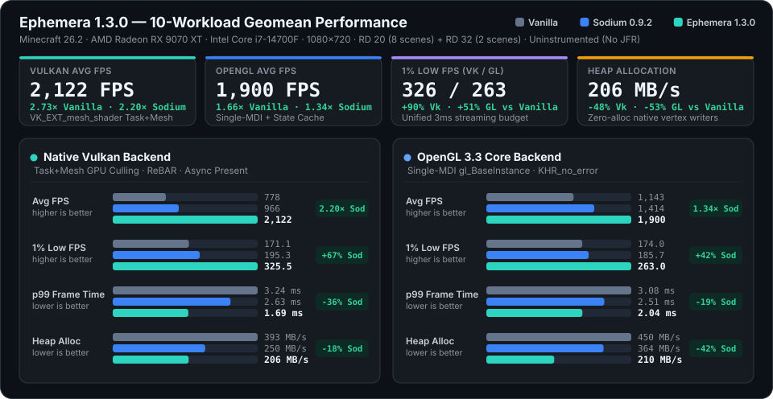
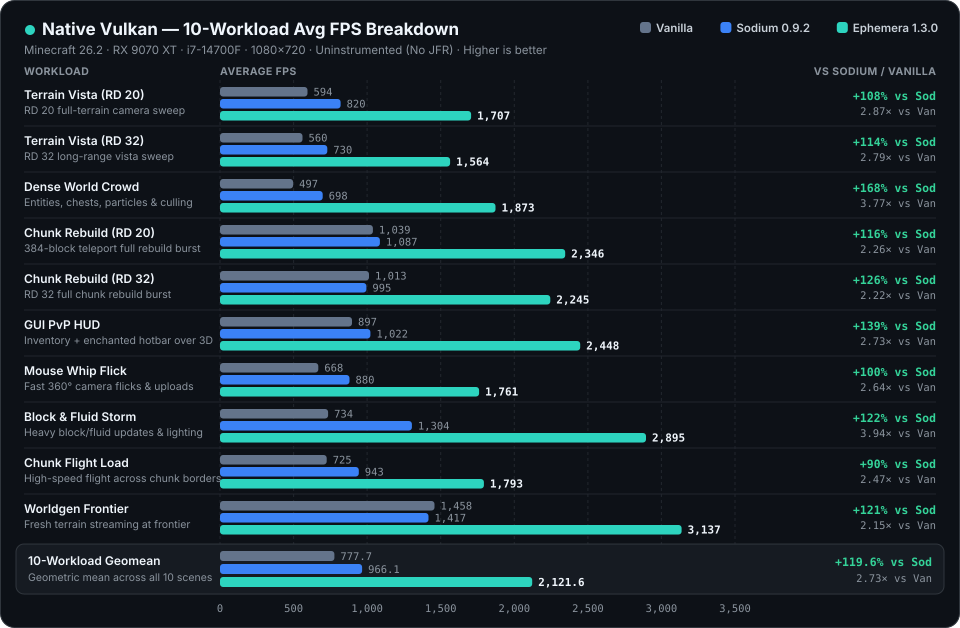
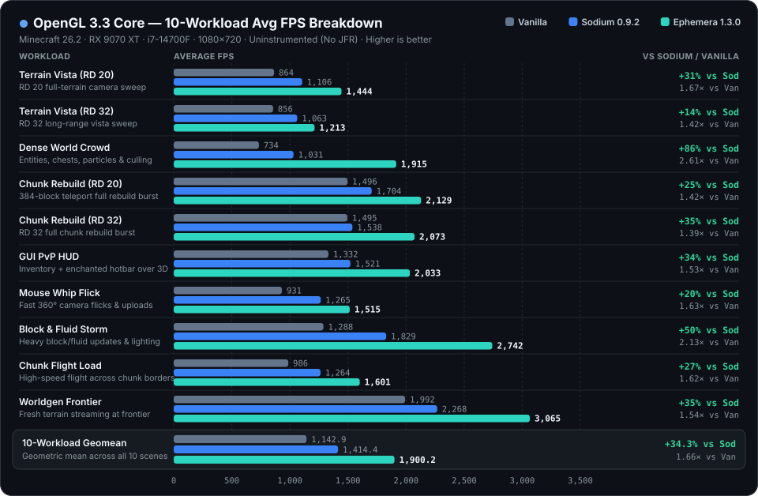
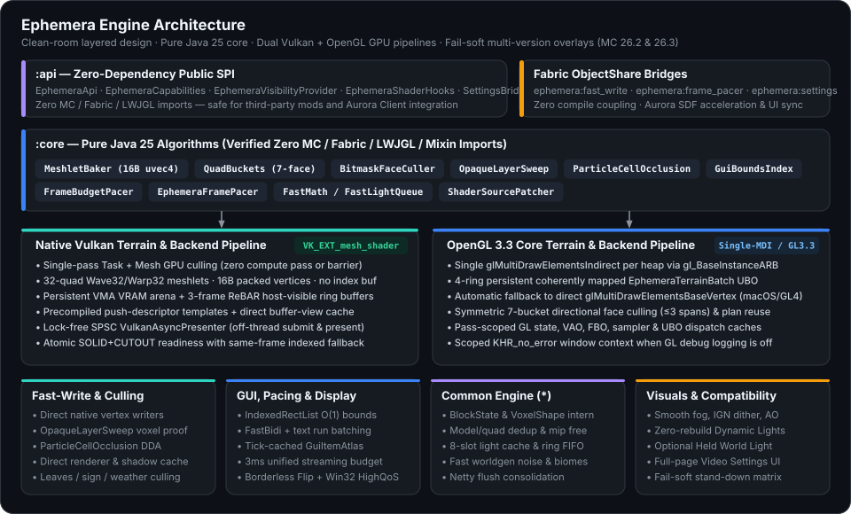

<p align="center">
  
</p>

<h1 align="center">Ephemera</h1>

<p align="center">
  <strong>Clean-room, MIT-licensed full-stack Minecraft performance engine for Fabric</strong><br />
  Native <strong>Vulkan (<code>VK_EXT_mesh_shader</code>)</strong> &amp; <strong>OpenGL 3.3 Core</strong> &middot; Minecraft <strong>26.2 &amp; 26.3</strong> &middot; Java 25 &middot; Client + Dedicated Server (<code>environment: "*"</code>)
</p>

<p align="center">
  <a href="https://github.com/kalibsolomon-pixel/Ephemera/releases/latest"></a>
  
  
  
  <a href="LICENSE"></a>
</p>

---

**Ephemera** is a standalone, single-JAR Fabric performance engine that accelerates Minecraft from chunk generation and memory storage all the way through culling, vertex emission, GUI batching, frame pacing, and modern GPU terrain submission on **both Native Vulkan and OpenGL**. It also ships as the default managed performance engine in [Aurora Launcher](https://github.com/kalibsolomon-pixel/Aurora-Launcher) alongside [Aurora Client](https://github.com/kalibsolomon-pixel/Aurora-Client).

## Why Ephemera?

| Advantage | What It Delivers |
|---|---|
| **One Mod, Full Stack** | Combines terrain rendering, GPU dispatch caching, native vertex fast-write, entity/block-entity/particle/block-state culling, GUI &amp; text batching, memory deduplication, fast lighting, worldgen noise/biome math, Netty flush consolidation, and frame pacing in one ~880 KB JAR (`environment: "*"` for both client and dedicated servers). |
| **Native Vulkan Faster Than OpenGL** | On modern AMD (RDNA 2/3/4) and NVIDIA (RTX 20–50) GPUs, Ephemera's cross-vendor `VK_EXT_mesh_shader` single-pass **Task + Mesh** pipeline with ReBAR ring buffers and asynchronous queue presentation delivers **2.73&times; Vanilla** and **2.20&times; Sodium** geomean FPS — turning Vulkan into the fastest backend (+12% avg / +24% 1% lows over OpenGL). |
| **First-Class OpenGL 3.3 Core** | Single `glMultiDrawElementsIndirect` per vertex heap via `gl_BaseInstanceARB` (with automatic fallback to direct `glMultiDrawElementsBaseVertex` on macOS GL 4.1 / older drivers), pass-scoped GL state/VAO/FBO/UBO caches, and scoped `KHR_no_error` contexts deliver **1.66&times; Vanilla** and **1.34&times; Sodium** geomean FPS. |
| **Smooth Frame Pacing &amp; 1% Lows** | A unified per-frame chunk-streaming budget, anti-sawtooth adaptive frame pacer, exact-flip borderless fullscreen, and Win32 HighQoS P-core scheduling boost **1% Low FPS by +51% to +90%** over Vanilla and **+42% to +67%** over Sodium while cutting heap allocations in half (**&minus;48% to &minus;53%**). |
| **Zero-Overhead Visual Polish &amp; Modern UI** | Built-in smooth fog, interleaved gradient dithering, enhanced AO, anisotropic mipmaps, smooth chunk fade, zero-rebuild dynamic lights, and optional Held World Light — all automatically standing down when an Iris/Oculus shader pack is active — paired with a full-page Video Settings screen and live diagnostics. |
| **Fail-Soft &amp; Clean-Room MIT** | Per-mixin automatic stand-downs let Ephemera coexist cleanly with specialized mods (`Sodium`, `Iris`, `Lithium`, `C2ME`, `ImmediatelyFast`, `EntityCulling`, `MoreCulling`, `FerriteCore`, `ScalableLux`, `Krypton`, etc.). Pure Java 25 algorithms live in `:core` with zero Minecraft/Fabric/LWJGL dependencies. |

---

## Performance Benchmarks

All benchmarks below were measured **uninstrumented (`--no-jfr`)** on a quiet system across Ephemera's standardized **10-workload suite** (8 workloads at Render Distance 20 + 2 workloads at Render Distance 32):

- **Test System**: AMD Radeon RX 9070 XT (driver 26.11.2) &middot; Intel Core i7-14700F &middot; 1080&times;720 &middot; Minecraft 26.2 &middot; Fabric Loader 0.20.1 &middot; Java 25
- **Configs Tested**: Vanilla 26.2 &middot; Sodium `0.9.2+mc26.2` &middot; **Ephemera `1.3.0`**

<p align="center">
  <picture>
    <source media="(prefers-color-scheme: dark)" srcset="docs/assets/bench-overview-dark.svg" />
    <source media="(prefers-color-scheme: light)" srcset="docs/assets/bench-overview-light.svg" />
    
  </picture>
</p>

### 10-Workload Geometric Mean Summary

| Backend | Metric | Vanilla 26.2 | Sodium 0.9.2 | **Ephemera 1.3.0** | vs. Vanilla | vs. Sodium |
|---|---|---:|---:|---:|---:|---:|
| **Vulkan** | **Avg FPS** *(higher is better)* | 777.7 | 966.1 | **2,121.6** | **+172.8% (2.73&times;)** | **+119.6% (2.20&times;)** |
| **Vulkan** | **1% Low FPS** *(higher is better)* | 171.1 | 195.3 | **325.5** | **+90.2% (1.90&times;)** | **+66.7% (1.67&times;)** |
| **Vulkan** | **p99 Frame Time** *(lower is better)* | 3.24 ms | 2.63 ms | **1.69 ms** | **&minus;47.8%** | **&minus;35.8%** |
| **Vulkan** | **Heap Allocation** *(lower is better)* | 392.6 MB/s | 250.4 MB/s | **205.6 MB/s** | **&minus;47.6%** | **&minus;17.9%** |
| **OpenGL** | **Avg FPS** *(higher is better)* | 1,142.9 | 1,414.4 | **1,900.2** | **+66.3% (1.66&times;)** | **+34.3% (1.34&times;)** |
| **OpenGL** | **1% Low FPS** *(higher is better)* | 174.0 | 185.7 | **263.0** | **+51.1% (1.51&times;)** | **+41.6% (1.42&times;)** |
| **OpenGL** | **p99 Frame Time** *(lower is better)* | 3.08 ms | 2.51 ms | **2.04 ms** | **&minus;33.7%** | **&minus;18.6%** |
| **OpenGL** | **Heap Allocation** *(lower is better)* | 449.6 MB/s | 363.8 MB/s | **210.5 MB/s** | **&minus;53.2%** | **&minus;42.1%** |

### Per-Workload Breakdown

<p align="center">
  <picture>
    <source media="(prefers-color-scheme: dark)" srcset="docs/assets/bench-workloads-vulkan-dark.svg" />
    <source media="(prefers-color-scheme: light)" srcset="docs/assets/bench-workloads-vulkan-light.svg" />
    
  </picture>
</p>

<p align="center">
  <picture>
    <source media="(prefers-color-scheme: dark)" srcset="docs/assets/bench-workloads-opengl-dark.svg" />
    <source media="(prefers-color-scheme: light)" srcset="docs/assets/bench-workloads-opengl-light.svg" />
    
  </picture>
</p>

<details>
<summary><strong>Full 10-Workload Raw Data &amp; Congested Multiplayer Hub Results</strong></summary>

#### Native Vulkan (MC 26.2, No JFR)

| Workload | Vanilla FPS / 1%L | Sodium 0.9.2 FPS / 1%L | **Ephemera 1.3.0 FPS / 1%L** | p99 (Van / Sod / **Eph**) | Alloc MB/s (Van / Sod / **Eph**) |
|---|---:|---:|---:|---:|---:|
| `terrain_vista_rd20` | 594.5 / 142.0 | 819.9 / 173.5 | **1,706.6 / 256.9** | 4.64 / 3.02 / **2.08 ms** | 373.9 / 167.4 / **133.2** |
| `terrain_vista_rd32` | 560.4 / 124.4 | 729.5 / 118.8 | **1,564.0 / 254.4** | 5.07 / 3.87 / **2.20 ms** | 338.3 / 164.1 / **125.7** |
| `dense_world_crowd` | 496.6 / 184.6 | 697.7 / 216.5 | **1,872.6 / 422.6** | 3.99 / 2.99 / **1.67 ms** | 573.9 / 446.3 / **343.3** |
| `chunk_rebuild_burst` | 1,038.8 / 157.6 | 1,086.7 / 170.4 | **2,346.1 / 296.0** | 2.65 / 2.50 / **1.60 ms** | 335.9 / 256.8 / **173.8** |
| `chunk_rebuild_burst_rd32` | 1,012.8 / 137.0 | 995.2 / 111.1 | **2,244.6 / 247.8** | 2.60 / 2.79 / **1.56 ms** | 248.1 / 242.6 / **174.1** |
| `gui_pvp_hud` | 897.0 / 245.3 | 1,022.2 / 262.4 | **2,447.8 / 433.5** | 2.37 / 2.15 / **1.47 ms** | 352.3 / 246.2 / **338.6** |
| `mouse_whip_flick` | 667.8 / 116.3 | 880.4 / 138.4 | **1,761.0 / 189.4** | 4.35 / 3.99 / **2.60 ms** | 400.4 / 233.8 / **235.0** |
| `block_fluid_storm` | 734.4 / 238.9 | 1,304.5 / 382.1 | **2,894.9 / 613.9** | 2.70 / 1.84 / **1.00 ms** | 633.8 / 286.3 / **254.6** |
| `chunk_flight_load` | 725.2 / 152.6 | 943.1 / 195.6 | **1,793.2 / 244.7** | 4.63 / 2.88 / **2.40 ms** | 510.6 / 304.4 / **211.7** |
| `worldgen_frontier` | 1,457.5 / 294.1 | 1,417.0 / 352.4 | **3,136.9 / 534.6** | 1.53 / 1.45 / **1.08 ms** | 314.9 / 252.5 / **181.3** |
| **Geomean (10 scenes)** | **777.7 / 171.1** | **966.1 / 195.3** | **2,121.6 / 325.5** | **3.24 / 2.63 / 1.69 ms** | **392.6 / 250.4 / 205.6** |

#### OpenGL 3.3 Core (MC 26.2, No JFR)

| Workload | Vanilla FPS / 1%L | Sodium 0.9.2 FPS / 1%L | **Ephemera 1.3.0 FPS / 1%L** | p99 (Van / Sod / **Eph**) | Alloc MB/s (Van / Sod / **Eph**) |
|---|---:|---:|---:|---:|---:|
| `terrain_vista_rd20` | 863.7 / 148.8 | 1,105.6 / 136.3 | **1,444.4 / 210.6** | 4.26 / 3.15 / **2.72 ms** | 370.7 / 240.9 / **127.8** |
| `terrain_vista_rd32` | 855.5 / 119.4 | 1,063.0 / 145.2 | **1,212.7 / 176.4** | 4.42 / 3.27 / **3.27 ms** | 397.5 / 239.1 / **116.2** |
| `dense_world_crowd` | 733.5 / 245.6 | 1,031.0 / 247.8 | **1,915.4 / 420.5** | 3.06 / 2.57 / **1.65 ms** | 652.2 / 625.1 / **400.8** |
| `chunk_rebuild_burst` | 1,496.1 / 150.1 | 1,703.9 / 134.9 | **2,129.1 / 218.4** | 2.68 / 2.32 / **1.96 ms** | 349.0 / 396.6 / **182.3** |
| `chunk_rebuild_burst_rd32` | 1,494.7 / 140.6 | 1,538.0 / 116.4 | **2,073.1 / 184.4** | 3.36 / 2.98 / **2.12 ms** | 355.6 / 372.5 / **184.4** |
| `gui_pvp_hud` | 1,331.6 / 210.3 | 1,521.2 / 193.9 | **2,032.6 / 338.8** | 2.39 / 2.12 / **1.75 ms** | 441.2 / 375.0 / **325.1** |
| `mouse_whip_flick` | 930.9 / 112.0 | 1,265.3 / 155.1 | **1,514.8 / 181.3** | 4.58 / 3.64 / **2.73 ms** | 418.0 / 296.2 / **230.7** |
| `block_fluid_storm` | 1,288.5 / 365.4 | 1,829.1 / 437.1 | **2,742.5 / 570.8** | 2.01 / 1.53 / **1.05 ms** | 729.1 / 426.5 / **262.4** |
| `chunk_flight_load` | 986.1 / 141.0 | 1,263.7 / 206.4 | **1,601.1 / 178.0** | 4.54 / 3.03 / **3.49 ms** | 476.5 / 389.9 / **215.7** |
| `worldgen_frontier` | 1,992.1 / 227.8 | 2,268.0 / 233.8 | **3,065.3 / 402.9** | 1.50 / 1.51 / **1.18 ms** | 441.9 / 413.3 / **201.1** |
| **Geomean (10 scenes)** | **1,142.9 / 174.0** | **1,414.4 / 185.7** | **1,900.2 / 263.0** | **3.08 / 2.51 / 2.04 ms** | **449.6 / 363.8 / 210.5** |

#### Congested Multiplayer Hub (Dedicated Server TCP, 2560&times;1440, Borderless)

Tested against a live dedicated server (`compression=256`) with 120 TextDisplays, 64 ArmorStands, 80 mobs, 80 ItemDisplays, 40 player skulls, live scoreboard/bossbar/chat/particle packets:

| Scenario | Vulkan (Vanilla &rarr; **Ephemera**) | OpenGL (Vanilla &rarr; **Ephemera**) |
|---|---:|---:|
| **Crowded Hub Plaza** | 725.5 &rarr; **1,453.8 FPS** (**2.00&times;**) &middot; &minus;52.7% alloc | 886.8 &rarr; **1,469.4 FPS** (**1.66&times;**) &middot; &minus;68.8% alloc |
| **Occluded Market Hall** | 847.5 &rarr; **1,674.0 FPS** (**1.98&times;**) &middot; &minus;54.2% alloc | 1,059.7 &rarr; **1,578.7 FPS** (**1.49&times;**) &middot; &minus;71.9% alloc |
| **Congested PvP Whip** | 609.7 &rarr; **1,410.7 FPS** (**2.31&times;**) &middot; &minus;50.0% alloc | 820.2 &rarr; **1,282.3 FPS** (**1.56&times;**) &middot; &minus;70.2% alloc |

</details>

---

## How Ephemera Works

<p align="center">
  <picture>
    <source media="(prefers-color-scheme: dark)" srcset="docs/assets/architecture-dark.svg" />
    <source media="(prefers-color-scheme: light)" srcset="docs/assets/architecture-light.svg" />
    
  </picture>
</p>

### 1. Dual-Backend Terrain Engine

Ephemera accelerates terrain compilation off-thread and submits visible geometry through specialized hardware paths on both backends while keeping full compatibility with Minecraft's block models, translucent sorting, and resource packs:

- **Native Vulkan (`VK_EXT_mesh_shader` Single-Pass Task + Mesh)** — On modern AMD (RDNA 2/3/4) and NVIDIA (Turing/Ampere/Ada/Blackwell) GPUs:
  - Off-thread `MeshletBaker` packs vanilla 28-byte `BLOCK` quads into **16-byte `uvec4` vertices** (64 bytes/quad, zero index buffer) grouped into **32-quad hardware meshlets** (128 vertices, 64 triangles — matching one AMD Wave32 / NVIDIA Warp32) with quantized 8-bit local AABBs.
  - A single hardware **Task Shader** (`local_size_x = 32`) evaluates section fog occlusion, 7-bucket directional face culling, and per-meshlet AABB frustum culling on-chip, precomputing `mvp` once per section and passing surviving meshlets directly via `taskPayloadSharedEXT` — **zero compute pass, zero compute-to-graphics barrier, zero `visibleMeshlets` VRAM traffic**, and one `vkCmdDrawMeshTasksEXT` per opaque layer.
  - Static pools reside in device-local VRAM via VMA (`quadBuf`, `meshletBuf`, `sectionMetaBuf`), while per-frame buffers (`visibleTasksRing`, `cullParamsRing`, `meshFrameRing`) use **3-frame host-visible mapped ReBAR/SAM rings** for zero-copy CPU writes without steady-state `vkCmdUpdateBuffer` barriers.
  - **Atomic Same-Frame Fallback**: Both `SOLID` and `CUTOUT` pipelines are pre-warmed off-pass and verified before frame handoff; any shader/pipeline failure or external shader pack transparently falls back to indexed multi-draw on the exact same frame with zero missing terrain.
  - **Asynchronous Vulkan Queue Present (`VulkanAsyncPresenter`)**: Moves blocking WDDM/DWM kernel transitions (`vkQueueSubmit2KHR` ~70–130 &mu;s and `vkQueuePresentKHR` ~250 &mu;s) onto a dedicated FIFO worker thread through a lock-free SPSC ring buffer while preserving strict Vulkan external synchronization.
- **OpenGL 3.3 Core (`GlSingleMdiTerrain` &amp; Regional Multi-Draw)**:
  - Collapses every solid and cutout draw on a vertex heap into **one `glMultiDrawElementsIndirect`** regardless of region or fading state, reading per-draw `(origin, visibility)` via `gl_BaseInstanceARB` from a 4-buffer persistent coherently mapped `EphemeraTerrainBatch` UBO ring.
  - On devices without `ARB_shader_draw_parameters` / `ARB_buffer_storage` (e.g. macOS GL 4.1 or older Intel iGPUs) or custom resource-pack terrain shaders, seamlessly falls back to regional direct `glMultiDrawElementsBaseVertex` (zero indirect buffer upload) or per-section draws.
- **Shared Terrain Compiler &amp; Planner Optimizations**:
  - **Symmetric 7-Bucket Directional Face Culling (`QuadBuckets`)**: Reorders quads into `[EAST, UP, SOUTH, UNASSIGNED, NORTH, DOWN, WEST]` so any visible camera octant coalesces into at most **3 contiguous draw spans**, cutting ~45% of back-facing rasterizer work.
  - **18&sup3; Bitmask Buried-Block Culling (`BitmaskFaceCuller`)**: Skips tessellation for solid vanilla blocks enclosed by six full opaque neighbors.
  - **Fog Occlusion, Radix Translucent Sort &amp; Visible-Only Sprite Animation**: Skips fog-occluded sections, replaces merge sort with a stable radix distance sort, skips off-screen animated block-atlas blits, and reuses the entire `RegionalChunkBatchPlan` across stationary frames (`TerrainTopology` invalidation).

### 2. Zero-Allocation Vertex Fast-Write &amp; Backend Dispatch Caches

- **Direct Native-Memory Vertex Writers**: Single-pass off-heap emission (`FastQuadWriter`, `FastCuboidWriter`, `FastParticleQuadWriter`, `FastGlyphWriter`, `FastShadowWriter`, `FastLineWriter`) eliminates intermediate scratch arrays and `ThreadLocal` lookups for baked quads, entity cuboids (transforming 8 unique corners and copying side faces directly in native memory), particles, shadows, and text glyphs.
- **Vulkan Dispatch &amp; Buffer-View Caching**: Precompiles per-layout `VulkanDescriptorPlan` templates to push descriptors with contiguous stack allocations and zero per-draw `HashMap.get` lookups, plus a 16-entry per-buffer `VkBufferView` cache on `VulkanGpuBuffer.Direct`.
- **OpenGL Dispatch Cache &amp; `KHR_no_error`**: Pass-scoped tracking skips redundant sampler, UBO, VAO, FBO, scissor, polygon-mode, and draw-buffer calls (resetting every pass so raw GL mods remain safe), and enables `KHR_no_error` on context creation when GL debug logging is off.

### 3. Conservative Occlusion &amp; Entity / Particle Culling

- **`OpaqueLayerSweep` &amp; `SectionBlockCache`**: Proves full-voxel opaque layers separating camera and target bounds using a 256-slot frame-scoped `SectionBlockCache` with lazy 4096-bit section opacity bitsets, bounded at 512 reads and cached in direct-mapped primitive sweep tables. Always fails open for bosses, glowing/named/leashed entities, beacons, global renderers, and modded renderer classes.
- **Particle &amp; Block-State Culling**: `ParticleCellOcclusion` runs a bounded dominant-axis DDA cached in a 4,096-entry direct-mapped cell table alongside tick-paced particle lightmap caching and thread-local rotation quaternions. Additional culling covers deep interior leaves (`DEPTH` / `CHECK_SURROUNDING` / `FAST_OPAQUE`), back-facing sign text, occluded item frames/paintings, rain/snow columns, and extruded cloud allocations.
- **Direct Renderer &amp; Shadow Caches**: Caches entity and block-entity renderer lookups directly on `EntityType` / `BlockEntityType` (zero G1GC write barriers on hits) plus a single-lookup pass cache for players/modded renderers and a 4,096-slot static ground-surface cache for entity shadows.

### 4. GUI, Text &amp; Item Rendering

- **`IndexedRectList` &amp; `GuiBoundsIndex`**: Replaces linear GUI intersection scans (`~12%` of frame time in HUD-heavy scenes) with an incremental flat-`int[]` bounds index + union bounding box, turning misses into 4 integer comparisons with zero `IdentityHashMap` overhead.
- **Text &amp; Font Pipeline**: Pure left-to-right `FastLtrDetector` / `FastBidi` bypasses ICU `Bidi` for standard text, `TextDecorationRunMerger` merges contiguous underline/strikethrough runs, `GuiTextBatcher` batches text runs (preserving linear SDF filtering for Aurora Client), and font atlas pages resize to `1024&times;1024` to stop texture thrashing.
- **Tick-Cached `GuiItemAtlas`**: Keeps animated sprite slots alive across frames (redrawing only on `TextureManager.tick()`), optionally rate-limits enchantment glint redraws, caches resolved `ItemStack` render states copy-free via `PatchedDataComponentMap` copy-on-write tokens, and memoizes atlas slots on hash-caching `ModelIdentityKey`s.

### 5. Frame Pacing, Unified Streaming Budget &amp; Display Presentation

- **Unified Per-Frame Chunk-Streaming Budget (`FrameBudgetPacer`)**: Shares one 3.0 ms uncapped budget (75% snapshot reserve) and a hard display-period deadline on capped frames across both section snapshots and Vulkan mesh uploads, backed by an O(1) two-tier nearby/distant pending upload queue so chunk streaming never tanks 1% / 0.1% lows.
- **Precision Frame Pacer (`EphemeraFramePacer`)**: Double-precision nanosecond cadence (no integer drift at 144/165/240/360 Hz), fast-attack/slow-decay adaptive OS wakeup overshoot estimation, bounded interrupt-safe re-park + `Thread.onSpinWait()` tail, and anti-sawtooth soft phase recovery.
- **Borderless Fullscreen, Win32 HighQoS &amp; Capture Awareness**: Strips DWM border/rounding attributes for exact-resolution Independent Flip borderless fullscreen, opts the render thread out of Windows 11 EcoQoS/Power Throttling with P-core HighQoS scheduling and 1 ms high-resolution waitable timers, and automatically detects active capture tools (OBS, etc.) to trim busy-spin windows and yield cleanly to encoders.

### 6. Common Engine: Memory, Lighting, Worldgen &amp; Networking (`environment: "*"`)

Every common optimization runs on **both clients and dedicated servers**:

- **Memory Deduplication &amp; Leak Guards**: Interns identical `BlockState` caches, property tuples, `VoxelShape` coordinate lists, and baked model quads; releases unused upper sprite mipmaps after atlas upload; trims bloated off-heap `ByteBufferBuilder` allocations; and sweeps world-scoped caches on disconnect/reload.
- **Lighting Engine**: Expands `LightEngine` and `DataLayerStorageMap` lookup caches to 8 slots, uses separate flat ring FIFOs (`FastLightQueue`), and fast-paths uniform light `DataLayer` reads — bit-verified against vanilla across 221,184 sampled positions.
- **Worldgen, Storage &amp; Networking**: Compact 16 KiB sine table (`FastMath`), power-of-two chunk modulo &amp; cached minimum section index, `PalettedContainer` scratch-array pooling, `LinearPalette` primitive index cache, fast noise/aquifer/beardifier/biome/material-system paths (on both 26.2 and 26.3), Netty flush consolidation (256-request threshold), and fast `VarInt` / `VarLong` codecs.

### 7. Built-In Visual Enhancements &amp; Full-Page Video Settings

All visual features are live-configurable, sub-0.05 ms overhead, and automatically yield whenever an Iris/Oculus shader pack is active:

- **Smooth Fog &amp; Interleaved Gradient Dithering**: Hermite smoothstep fog curve with zero-centered IGN dithering across terrain, sky, clouds, entities, and particles to eliminate 8-bit sky/fog banding.
- **Atmospheric Horizon, Enhanced AO, Crisp Anisotropic Mipmaps, Smooth Chunk Fade, Underwater Clarity**: Subtle horizon warmth, tunable AO contrast curve, Blaze3D anisotropic block-atlas samplers (up to 16&times; on both backends), cubic ease-out chunk fade-in, and optional extended underwater visibility.
- **Dynamic Lights &amp; Optional Held World Light**: Zero-chunk-rebuild entity/hand dynamic lights via a 16-block spatial hash (`DynamicLightGrid`), plus an optional opt-in **Held World Light** shader mode that illuminates nearby terrain around your held light source with wall-leak clamping.
- **Full-Page Video Settings UI (`EphemeraSettingsScreen`)**: Replaces vanilla Video Settings with a tabbed sidebar carrying every Minecraft Display &amp; Quality option (including sliders for GUI Scale and Windowed / Borderless / Exclusive fullscreen mode) alongside dedicated Ephemera Performance, Terrain, Culling, Engine &amp; Memory, Visuals, and live **Diagnostics** pages (FPS, median, p99, 1%/0.1% lows, mixin health, occlusion counters, and optional HUD overlay). The original vanilla screen stays one click away.

---

## Repository &amp; Multi-Version Architecture

Ephemera builds per-version runtime JARs from one shared codebase (`ephemera-<version>-mc<minecraft>.jar`):

| Module / Directory | Scope |
|---|---|
| [`:api`](api/src/main/java/com/ephemera/api) | Zero-dependency public SPI (`EphemeraApi`, `EphemeraCapabilities`, `EphemeraSettingsBridge`, `EphemeraVisibilityProvider`, `EphemeraShaderHooks`) |
| [`:core`](core/src/main/java/com/ephemera/core) | Pure Java 25 algorithms with **zero** Minecraft/Fabric/LWJGL/Mixin imports (enforced by `:core:verifyLayering` and backed by 46 JUnit test suites) |
| [`src/main`](src/main/java/com/ephemera) | Common (`*`) chunk storage, block-state/shape interning, lighting, worldgen, and networking mixins |
| [`src/client`](src/client/java/com/ephemera) | Shared client culling, GUI/text/item caches, frame pacing, Win32 display runtime, visuals, settings UI, and `ObjectShare` bridges |
| [`versions/26.2`](versions/26.2) &amp; [`versions/26.3`](versions/26.3) | Version overlays bridging Blaze3D (26.2 / GLFW) and RenderPearl (26.3 / SDL3 + OIT) via `RenderPlatform` and build-time class derivation (`derive.json`). See [docs/multi-version.md](docs/multi-version.md). |

Detailed technical module specifications live in [`docs/modules/`](docs/modules):
[terrain-eng.md](docs/modules/terrain-eng.md) &middot; [backend-fastwrite.md](docs/modules/backend-fastwrite.md) &middot; [culling-entities.md](docs/modules/culling-entities.md) &middot; [gui-text-items.md](docs/modules/gui-text-items.md) &middot; [engine-mem-light.md](docs/modules/engine-mem-light.md) &middot; [visuals-ui.md](docs/modules/visuals-ui.md)

---

## Compatibility, Stand-Downs &amp; Aurora Integration

Ephemera uses a fail-soft mixin plugin (`EphemeraCommonMixinPlugin` / `EphemeraClientMixinPlugin`) that automatically stands down overlapping mixins when specialized mods are detected:

| Subsystem | Automatically Stands Down For |
|---|---|
| **Terrain &amp; GPU Dispatch** | `sodium`, `vulkanmod`, `iris`, `oculus` (no-error/shader hooks), `canvas`, `nvidium` |
| **Native Vertex Fast-Write** | `sodium`, `iris`, `oculus`, `vulkanmod`, `immediatelyfast` |
| **Entity / Block / Particle Culling** | `entityculling`, `moreculling`, `particle_core`, `badoptimizations` |
| **GUI, Text &amp; Item Atlas** | `immediatelyfast`, `modernui`, `caxton`, `gnetum`, `polytone`, `dynamic_fps` |
| **Memory, Lighting, Worldgen &amp; Net** | `ferritecore`, `modernfix`, `lithium`, `radium`, `canary`, `c2me`, `noisium`, `vmp`, `scalablelux`, `starlight`, `krypton`, `rrls`, `fastload`, `fast-ip-ping` |
| **Borderless &amp; Dynamic Lights** | `borderless-mining`, `cubes-without-borders`, `fullscreen-windowed`, `lambdynlights`, `dynamiclights`, `ryoamiclights`, `sodiumdynamiclights` |

### Aurora Client Zero-Coupling Integration

When paired with [Aurora Client](https://github.com/kalibsolomon-pixel/Aurora-Client):
- Ephemera publishes `ephemera:fast_write`, `ephemera:frame_pacer`, and `ephemera:settings` via Fabric's `ObjectShare`, accelerating Aurora's SDF text/hitbox rendering, coordinating single-owner frame pacing without double-sleeping, and exposing Ephemera toggles inside Aurora's Settings UI with zero compile-time coupling.
- Builds advertise `ephemera:engine_ownership` and `ephemera:world_visual_ownership` in `fabric.mod.json` so updated Aurora clients yield overlapping hooks while Ephemera preserves linear SDF glyph filtering in `GuiTextBatcher`.

---

## Installation, Building &amp; Benchmarking

### Installation
1. Install **Fabric Loader 0.20.0+** for **Minecraft 26.2 or 26.3** (Java 25+).
2. Download the matching `ephemera-<version>-mc<minecraft>.jar` from [GitHub Releases](https://github.com/kalibsolomon-pixel/Ephemera/releases/latest) and place it in your `mods/` folder.
3. *(Optional)* Switch between **Vulkan** and **OpenGL** under **Video Settings &rarr; Display &rarr; Graphics API**.

### Building from Source

```bash
# Build & test default target (Minecraft 26.2)
./gradlew check build

# Build & test Minecraft 26.3
./gradlew -Pephemera.minecraft=26.3 check build
```

Output JARs:
- `build/libs/ephemera-<version>-mc26.2.jar`
- `build/minecraft-26.3/libs/ephemera-<version>-mc26.3.jar`

### Running the Benchmark Suite

```bash
# RD 20 (8 workloads) + RD 32 (2 workloads), uninstrumented
python tools/bench/run_bench.py --targets vanilla,sodium,ephemera --backends VULKAN,OPENGL --suite all --render-distance 20 --duration 4 --no-jfr
python tools/bench/run_bench.py --targets vanilla,sodium,ephemera --backends VULKAN,OPENGL --suite default --render-distance 32 --duration 3 --no-jfr
```

---

## License

MIT &mdash; see [LICENSE](LICENSE).
